# Collaterale — How to use

Collaterale compares and merges **text files**, **folders** and (soon) three-way merges, side by side, on Linux, macOS and Windows.
Every screenshot below is produced from the real application by `scripts/update-docs.sh`.

> This guide is updated with every commit that changes visible behavior (enforced by the pre-commit hook).

## Contents
1. [Installing and starting](#1-installing-and-starting)
1b. [The workspace: home screen and tabs](#1b-the-workspace-home-screen-and-tabs)
1c. [Command line and git integration](#1c-command-line-and-git-integration)
2. [Text compare](#2-text-compare)
3. [Folder compare](#3-folder-compare)
4. [Three-way merge](#4-three-way-merge)
5. [Hex compare](#5-hex-compare)
6. [Table compare](#6-table-compare)
7. [Picture compare](#7-picture-compare)
8. [Themes](#8-themes)
8b. [Options](#8b-options)
8c. [Sessions, workspaces, scripts and settings packages](#8c-sessions-workspaces-scripts-and-settings-packages)
8d. [Text edit, patches and the clipboard](#8d-text-edit-patches-and-the-clipboard)
9. [Keyboard shortcuts](#9-keyboard-shortcuts)
10. [Known limitations](#10-known-limitations)

---

## 1. Installing and starting

Download the package for your system from the project's **Releases** page (each release also lists `SHA256SUMS` so you can verify the download with `sha256sum -c SHA256SUMS`). Everything is self-contained: you do **not** need to install .NET.

### Linux

| Package | Install |
|---|---|
| `collaterale_<version>_amd64.deb` (Debian, Ubuntu, Mint…) | `sudo apt install ./collaterale_<version>_amd64.deb` — adds a menu entry and the `collaterale` command. Remove with `sudo apt remove collaterale`. |
| `Collaterale-<version>-linux-x64.tar.gz` / `linux-arm64` (any distribution) | Extract, then run `./install.sh` for a per-user install (menu entry + `collaterale` in `~/.local/bin`), or just run `./Collaterale`. Uninstall by deleting `~/.local/opt/collaterale`, `~/.local/bin/collaterale` and `~/.local/share/applications/collaterale.desktop`. |

### Windows

Run **`Collaterale-<version>-win-x64-setup.exe`** (per-user, no administrator needed; adds a Start menu entry and the Explorer context-menu items described under *File-manager integration*; remove it from *Settings → Apps*). Alternatively download `Collaterale-<version>-win-x64.zip`, extract it anywhere and double-click `Collaterale.exe` (portable: no Start menu entry or context menu). Because the build is not code-signed, Windows SmartScreen may say "Windows protected your PC": click **More info → Run anyway**.

### macOS

Download `Collaterale-<version>-osx-arm64.zip` (Apple silicon) or `-osx-x64.zip` (Intel), unzip, and drag **Collaterale.app** to *Applications*. The app is not signed or notarized, so the first time use **right-click → Open → Open**; if macOS still refuses, run `xattr -dr com.apple.quarantine /Applications/Collaterale.app` once.

### File-manager integration

Collaterale adds right-click entries so you can start a comparison without typing paths.

| System | What you get | How |
|---|---|---|
| **Linux – KDE Dolphin** | Select **two** files or two folders, right-click → **Collaterale → Compare the two selected items**. | Installed by the `.deb` and by `install.sh`. |
| **Linux – GNOME Files / Nemo / Caja** | Select two items, right-click → **Scripts → Compare with Collaterale**. | Installed by `install.sh` (per user). |
| **Windows Explorer** | Right-click the first item → **Collaterale: select as left side**, then right-click the second → **Collaterale: compare with the selected**. | Installed by the setup program. |
| **Any system** | The same two steps from a terminal or from a script: `collaterale --select-left <path>` and `collaterale --compare-selected <path>`. | Built in. |

On macOS you can drag two files onto the Collaterale icon, or use the same two terminal commands from a Shortcuts/Automator *Quick Action* that runs a shell script. The remembered left side is stored in `selected-left.txt` next to `settings.json` and is used once.

### Starting it

Launch it from your menu/Applications/Start folder, or from a terminal:

```bash
collaterale                          # home screen
collaterale left.txt right.txt       # compare two files right away
collaterale folderA folderB          # compare two folders
```

### Building from source

You need the **.NET 10 SDK**.

```bash
dotnet run --project src/Collaterale.App -- left.txt right.txt   # run from source
scripts/package.sh                                           # build all release packages
```

## 1b. The workspace: home screen and tabs

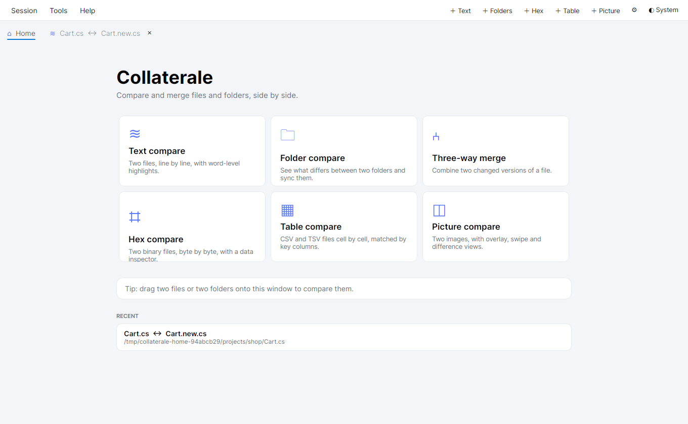

Collaterale opens on the **Home** tab. Every comparison you start gets its own **tab**, so you can keep several open and switch between them; close a tab with the **✕** on it (Home cannot be closed). A tab's title shows the two file names being compared.

* **Tiles** – *Text compare*, *Folder compare*, *Three-way merge*, *Hex compare*, *Table compare* and *Picture compare* open a blank session of that kind in a new tab, where you choose the files.
* **Recent** – your last 20 comparisons; click one to reopen it.
* **Drag and drop** – drop **exactly two files** (or two folders) anywhere on the window to compare them. Dropping anything else shows a hint at the top. For two files, Collaterale picks the view that suits them — see *Automatic view selection* below.
* **＋ Text / ＋ Folders / ＋ Hex / ＋ Table / ＋ Picture** (top right) – open a new blank text, folder, hex, table or picture compare tab.
* **Theme button** – cycles *System* (follows your OS), *Light* and *Dark*; remembered.

Settings (recent sessions, theme, default comparison options) are stored in a small JSON file: `~/.config/Collaterale/settings.json` on Linux, `~/Library/Application Support/Collaterale/settings.json` on macOS and `%APPDATA%\Collaterale\settings.json` on Windows. Delete it to reset; a missing or corrupt file is ignored.

## 1c. Command line and git integration

### Automatic view selection

When you give Collaterale **two files** — on the command line, by drag and drop, from a recent entry, or by double-clicking a pair in a folder comparison — it opens the view that fits them:

| The files are… | View |
|---|---|
| Pictures on both sides (`.png`, `.jpg`/`.jpeg`, `.gif`, `.bmp`, `.webp`, `.ico`) | **Picture compare** |
| `.csv` / `.tsv` on both sides | **Table compare** |
| Binary data (a NUL byte near the start, and not UTF-16 text) on either side | **Hex compare** |
| Anything else | **Text compare** |

Force a view with `--text`, `--hex`, `--table` or `--image` (for example `collaterale --text data.csv other.csv` to see a CSV as plain lines). Two folders always open a folder compare.

```text
collaterale                                   open the home screen
collaterale <left> <right>                    compare two files or two folders (the view is chosen from the files)
collaterale --text <left> <right>             always compare as text
collaterale --hex <left> <right>              compare two files byte by byte
collaterale --table <left> <right>            compare two CSV/TSV files cell by cell
collaterale --image <left> <right>            compare two pictures pixel by pixel
collaterale --merge --base B --left L --right R --output O
                                          three-way merge; the result is written to O
collaterale --help | --version
```

`--help` and `--version` print to the terminal and exit with code 0 without opening a window. (On Windows Collaterale is a GUI program, so run it from a terminal such as PowerShell to see that output.) Comparing a file with a folder is refused with a message. For a merge, `--base` is optional (without it the two sides are merged against an empty ancestor). Exit code **0** means success (a merge result was saved), **1** means the window was closed without saving or an error occurred.

### Switches and exit codes

Beyond the paths, a command line takes switches. Each can be written `-name`, `--name` or `/name` (a path that exists is never mistaken for a switch, so `/tmp/a` stays a path on Linux and macOS); those with a value take `=value` or the next argument.

| Command line | Meaning |
|---|---|
| `collaterale "My Session"` | Opens a saved session or workspace by name. |
| `collaterale L R` | Two files or two folders, as above. |
| `collaterale L R C` | Three files: a **Text Merge** with left, right and center (the common ancestor). |
| `collaterale L R C OUT` | Four files: the same, with the merge output. |
| `collaterale @script.txt` | Runs a script of commands without opening a window. |
| `collaterale settings.cpkg` | Imports a settings package. |
| `collaterale fix.patch` / `fix.diff` | Opens a patch in the Text Patch view. |
| `collaterale -` | Opens standard input (for example `ls -l \| collaterale -`) in a Text Edit view. |

| Switch | Meaning |
|---|---|
| `/automerge` | Merges three files with no window; writes the output unless there are conflicts. |
| `/force` | With `/automerge`, write conflicts to the output with conflict markers. |
| `/reviewconflicts` | With `/automerge`, open a Text Merge window only if there are conflicts. |
| `/iu`, `/ignoreunimportant` | Ignore unimportant (whitespace) differences while merging. |
| `/favorleft`, `/favorright` | Conflicts are resolved by taking that side. |
| `/center=FILE`, `/mergeoutput=FILE` | Name the merge's common ancestor or output when the files are given as a pair. |
| `/qc[=size\|crc\|sha1\|sha256\|binary]` | Quick compare of two files, answered by the exit code (below). With no type it uses the text rules. |
| `/fv=TYPE`, `/fileviewer=TYPE` | Force a view: `Text Compare`, `Text Merge`, `Table Compare`, `Hex Compare`, `Picture Compare`, `Media Compare`, `Folder Compare`, `Folder Merge`, `Folder Sync`, `Text Edit`, `Text Patch`. |
| `/edit` | Open one file in the Text Edit view. |
| `/sync` | Open two folders in the synchronize view. |
| `/expandall` | Expand all subfolders in the first folder comparison. |
| `/filters=*.cs;*.md` | Name filter of the first folder comparison. |
| `/ro`, `/ro1` `/lro` `/leftreadonly`, `/ro2` `/rro` `/rightreadonly` | Disable editing on both sides, the left or the right. |
| `/savetarget=FILE` | Save into this file instead of the opened one. |
| `/nobackups` | Do not make a backup before overwriting. |
| `/title1` … `/title4`, `/lefttitle` `/righttitle` `/centertitle` `/outputtitle` | Show this description instead of the path. |
| `/vcs1` … `/vcs4`, `/vcsleft` `/vcsright` `/vcscenter` `/vcsoutput` | Show this version-control path instead of the real one. |
| `/silent` | No interaction. |
| `/solo` | Always start a new instance. |
| `/closescript` | Close the script window when the script is done. |

Exit codes of the commands that finish without a window:

| Code | Meaning |
|---|---|
| 0 | Success |
| 1 | Binary same |
| 2 | Rules-based same (the bytes are identical) |
| 11 | Binary differences |
| 12 | Similar (the bytes differ, but the text rules find no difference, for example line endings only) |
| 13 | Rules-based differences |
| 14 | Conflicts detected (written with markers because of `/force`) |
| 100 | Unknown error |
| 101 | Conflicts detected, merge output not written |
| 105 / 106 / 107 | The script could not be loaded / has a syntax error / failed |

### Printing a diff in the terminal (no window)

`collaterale --diff left right` prints a standard **unified diff** and exits, without opening a window — handy over ssh, in scripts and in CI:

```bash
collaterale --diff old.txt new.txt              # unified diff, 3 lines of context
collaterale --diff old.txt new.txt -U 5 -w -i   # more context, ignore whitespace and case
collaterale --diff old.txt new.txt > change.patch && patch -p0 < change.patch
collaterale --diff dirA dirB --content          # folders: lists what differs, like `diff -rq`
```

| Option | Meaning |
|---|---|
| `-U N`, `--context N` | Lines of context around each change (default 3). |
| `-b` / `-w` / `-B` | Ignore changes in the *amount* of whitespace / all whitespace / leading and trailing whitespace. |
| `-i` | Ignore case. |
| `--ignore-strings` | Ignore the text inside string literals (language from the file name, or `--lang`). Can be combined with `--ignore-comments`. |
| `--ignore-comments`, `--lang ID` | Ignore comments; the language comes from the file name, or from `--lang` (`c-like`, `csharp`, `javascript`, `python`, `hash`, `markup`, `sql`, `lua`, `ini`, `php`, `css`, `haskell`, `jsonc`). |
| `--ignore-timestamps` | Ignore dates and times. |
| `--ignore-blank-lines` | Added or removed blank lines are not differences. |
| `--structure` | JSON/XML: compare the canonical structure (formatting and key/attribute order ignored). |
| `--patience`, `--histogram` | Use that algorithm instead of the default minimal one. |
| `--select-left <path>` / `--compare-selected <path>` | Two-step comparison for file managers: remember a file or folder as the left side, then compare it with another item (the entries in *File-manager integration*). |
| `--rows` | Print the side-by-side alignment as text (one row per line: same, changed, left-only, right-only, moved) instead of a patch — useful to compare alignment decisions between tools; see `docs/BEHAVIOR.md`. |
| `-q`, `--brief` | Only say whether the files differ. |
| `--content` | For folders, compare file contents instead of size and date. |

The output is a normal patch: it applies with `patch` or `git apply`, including files whose last line has no newline (marked `\ No newline at end of file`). Exit codes follow `diff`: **0** = no differences, **1** = differences, **2** = an error (message on stderr). Binary files are reported as "Binary files … differ" instead of being printed. For folders, entries inside a folder that exists on one side only are not listed one by one.

**Use Collaterale from git:**

```bash
git config --global diff.tool collaterale
git config --global difftool.collaterale.cmd 'collaterale "$LOCAL" "$REMOTE"'
git config --global merge.tool collaterale
git config --global mergetool.collaterale.cmd 'collaterale --merge --base "$BASE" --left "$LOCAL" --right "$REMOTE" --output "$MERGED"'
git config --global mergetool.collaterale.trustExitCode true
```
Then `git difftool` and `git mergetool` open Collaterale.

## 2. Text compare

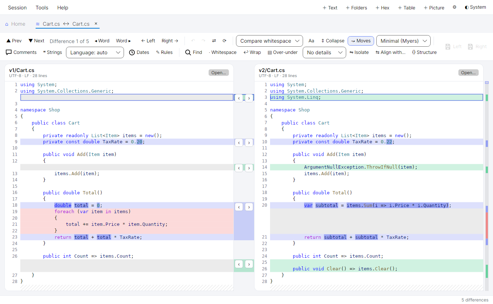

Two files are shown side by side. Both panes always have the same number of rows, so they scroll together; a blank grey row means "this line exists only on the other side".

### Reading the colors

| Color | Meaning |
|---|---|
| Blue band | A line that exists on both sides but differs. The **words that changed** inside the line get a stronger blue. |
| Red band (with a grey filler opposite) | A line that exists only on the **left** (it was removed on the right). |
| Green band (with a grey filler opposite) | A line that exists only on the **right** (it was added). |
| Purple | A block that was **moved**: removed here and inserted elsewhere unchanged (see *⤳ Moves* below). |
| Faint grey | Lines that only differ in ignored ways (for example whitespace when *Ignore all whitespace* is on). They are not counted as differences. |
| Blue outline | The **current difference**, the one the toolbar and keyboard shortcuts act on. |

When several lines were changed together, Collaterale pairs the lines that **look alike** instead of pairing them by position, so an edited line sits opposite its previous version even if other lines were added or removed around it. Similarity gives more weight to *distinctive* words than to words that appear in most of the changed lines (such as a shared prefix like `step 3:`), so lines are matched by what they say. `docs/BEHAVIOR.md` describes the corpus of tricky cases used to keep this behavior stable.

### The gutter between the panes

Each difference has a band in the strip between the panes, with two buttons:

* **›** copies the **left** version of this difference over the right side.
* **‹** copies the **right** version of this difference over the left side.

Click anywhere else on the band to make that difference the current one.

### Selecting whole lines (line-number margin)

Move the pointer over the **line numbers** at the left edge of a pane: the arrow turns into a mirrored arrow pointing up-right. **Click** there to select the whole line (its line break included); **click and drag** up or down to select several consecutive lines. The selection can then be copied, or used by **⇋ Isolate** and the other commands that work on the selected lines.

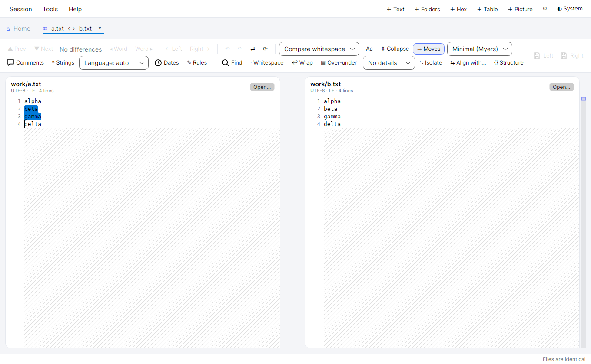

### The overview map (right edge)

A miniature of the whole file: colored marks show where the differences are and the translucent box shows what is on screen. Click or drag on it to jump; both panes follow and always stay level with each other.

### Toolbar

| Control | Action |
|---|---|
| **▲ Prev / ▼ Next** | Go to the previous / next difference (wraps around). The text shows "Difference 3 of 5". |
| **← Left / Right →** | Copy the current difference to the left / right side (same as the gutter buttons). |
| **↶ / ↷** | Undo / redo copy operations (up to 100 steps; **Ctrl+Z** / **Ctrl+Y**). |
| **⇄** | Swap the left and right files. |
| **⟳** | Reload: re-read both files from disk (discards unsaved copies; **F5**). |
| **Whitespace** | *Compare whitespace* (default), *Ignore amount of whitespace* (runs of spaces count as one), *Ignore leading/trailing whitespace*, or *Ignore all whitespace*. |
| **Aa** | Ignore letter case. |
| **Comments** + language list | **Ignore comments** (see *Smart rules* below). The list is *Language: auto* (taken from the file name) or a specific syntax. |
| **Dates** | Ignore dates and times in the text. |
| **✎ Rules** | Opens a panel with **Ignore blank lines** and your own rules: regular expressions (one per line) whose matches are ignored. |
| **⇋ Isolate** / **✕ Isolations** | Realign the selected lines on their own (see [Isolate](#isolate-realign-selected-lines)); **✕ Isolations** appears while any are active and removes them. |
| **{} Structure** | JSON and XML: compare the **structure** in a new tab (formatting and key/attribute order are ignored). |
| **⇕ Collapse** | **Fold long stretches of unchanged lines** so only the differences and **3 lines of context** around each remain. Each fold is a single marker row such as `⋯ 123 unchanged lines ⋯ (click to show)`; click it to reveal just that stretch. Hidden stretches shorter than four lines are simply shown, and two files with no differences are never collapsed. The gutter buttons, the overview map and ▲ Prev / ▼ Next all work on the shortened view. While collapsed the panes are **read-only** (click **⇕ Collapse** again to edit); copying a difference with the gutter or the toolbar still works. |
| **⤳ Moves** | Detect **moved blocks** (on by default): a run of at least 3 lines that was cut from one place and pasted in another is shown in **purple** on both sides instead of as an unrelated deletion plus addition, and the status bar says how many were found. It is still two differences for navigation and copying; the purple only tells you they are the same text. Very short or trivial runs (a few closing braces) are ignored, and the whitespace/case options apply to the matching. |
| **Algorithm** | *Minimal (Myers)* always finds the fewest changes. *Readable (patience)* anchors on lines that appear exactly once, which often gives a clearer picture for source code with many repeated lines such as `}`. *Smart (histogram)* anchors on the **rarest** lines instead, so repeated lines do not confuse it either; it is usually the best choice for source code. All three are exact in the sense that applying the shown changes to the left file always yields the right file. |
| **Left / Right** | Save that file (enabled once you have copied something into it). |

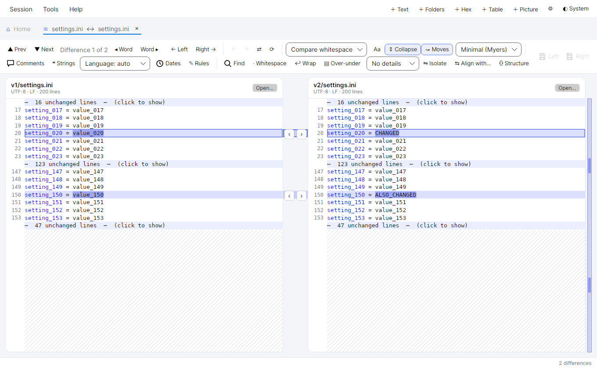

### Smart rules: what counts as a difference

Not every change matters. Collaterale can treat these as **unimportant**: they are shown in faint grey, are *not* counted as differences, and never get a ▲ Prev / ▼ Next stop.

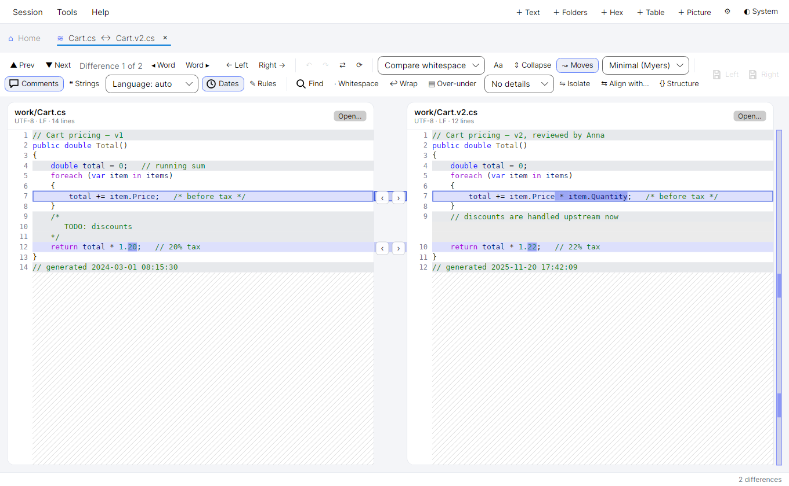

| Rule | What is ignored |
|---|---|
| **Whitespace** (list) | Indentation, runs of spaces, trailing spaces — see the toolbar table above. |
| **Line endings** | Always. `LF`, `CRLF` and old-Mac `CR` files compare equal when the text is the same; each pane's header still tells you its own style (for example `UTF-8 · CRLF · 120 lines`). |
| **Aa** | Letter case. |
| **Comments** | Comments of the file's language. A line whose only change is its comment, a comment line that was added or removed, and a block comment turned into a line comment are all unimportant. Commenting out code **is** a difference (the code disappeared). The highlight inside a changed line covers the code only. |
| **❝ Strings** | What a **string literal says**. `print("hello")` and `print("bonjour")` are the same; the quotes and the code around them still count, and so do comments (switch **Comments** on too to ignore both). Text inside multi-line strings (docstrings, verbatim and raw strings) is ignored on every line. Same language rules as comments. |
| **Dates** | Timestamps in lines: ISO 8601 (`2024-03-01T08:15:30Z`, `2024-03-01 08:15:30,123`), RFC 2822 (`Fri, 01 Mar 2024 08:15:30 GMT`), `March 1st, 2024`, `01/03/2024`, `31.12.2030`, clock times (`8:15 PM`, `12:34:56.789`). Two lines that differ only by such a value are equal. Version numbers and other digits are not touched. |
| **✎ Rules → Ignore blank lines** | Empty or whitespace-only lines that were added or removed are not differences (a blank line replaced by text still is). These lines, like comment-only lines, take no part in matching, so they can never pull real lines into a bogus change. |
| **✎ Rules** | Any regular expression you add (build numbers, `$Id: …$` keywords, generated markers). Regular-expression options work inside a rule, e.g. `(?i)build \d+` ignores that text whatever its letter case, so case can be handled rule by rule instead of for the whole file. |

**Choosing which parts of the code matter.** Comments, string contents and the code itself are the *syntax elements* Collaterale tells apart. Turn on **Comments** to say "comments are unimportant", **❝ Strings** to say "what strings say is unimportant", both to leave **only the code** as important, or neither to treat everything as important. A line that differs only in an unimportant element is shown in faint grey and is not a difference; a line whose code changed is a difference whatever its comments or strings say. The same two switches exist in a folder compare's content rules (see below) and on the command line (`--ignore-comments`, `--ignore-strings`).

**Comments by language.** The language is chosen from the file name, or from the list next to **Comments**; Collaterale understands string literals, so a `//` inside a string is code, and comments and strings that span lines are tracked.

| Language | Comments recognised |
|---|---|
| C, C++, Java, Go, Rust, Swift, Kotlin, Scala, Dart… | `// …`, `/* … */` |
| C# | `// …`, `/* … */`; verbatim (`@"…"`), interpolated-verbatim and raw (`"""…"""`) strings are respected |
| JavaScript, TypeScript, Vue, Svelte | `// …`, `/* … */`; template strings (backticks) across lines |
| JSON with comments, JSON5 | `// …`, `/* … */` |
| Python | `# …`; triple-quoted strings (docstrings) are text, not comments |
| Shell, Ruby, YAML, TOML, Makefile, PowerShell, Perl… | `# …` when the `#` starts the line or follows a space (so `${#arr}` and `a#b` stay code) |
| HTML, XML, SVG, XAML, project files | `<!-- … -->` across lines (scripts and styles embedded in HTML are not looked into) |
| SQL | `-- …`, `/* … */`; `'it''s'` strings |
| PHP, CSS/SCSS/Less, Lua, Haskell, INI/properties | their own comment forms |

If you switch on **Comments** for a file whose language Collaterale does not know, the status line asks you to pick one in the list. Comment rules apply to the two-file text compare and to `collaterale --diff --ignore-comments`; **three-way merge** deliberately does not ignore comments, because a merge result must never silently drop someone's edit.

**Structure (JSON and XML).** **{} Structure** rewrites both files into one canonical layout in a **new tab**: one value per line, two-space indentation, JSON object keys and XML attributes in alphabetical order, `<e></e>` written as `<e />`. The comparison there shows only changes of meaning — a re-formatted or re-ordered file compares equal — while array order, values and element order still count. Numbers keep their spelling (`1.50` stays `1.50`). That tab is a temporary view: it is not tied to a file, so nothing you do there changes your originals. A file that is not valid JSON/XML is reported instead of compared.

### Syntax coloring and finding text

Text is **colored by language**, chosen from the file extension (C#, C/C++, Java, JavaScript/TypeScript, Python, Rust, Go, JSON, XML, HTML, CSS, Markdown, shell, YAML, SQL and many more). The colors follow the light/dark theme and sit under the comparison colors, so you can read code and see differences at the same time. Unknown file types simply stay plain.

### Finding and replacing text

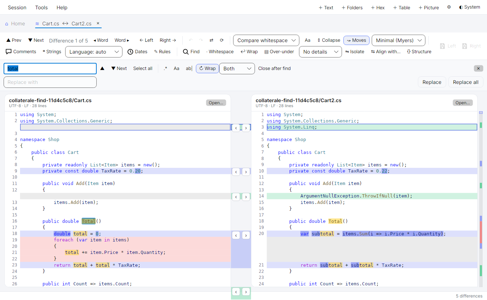

**Ctrl+F** (or **Find**) opens the find panel; **Ctrl+H** adds the replace line. If text is selected, or the cursor is on a word, that text fills the find box. Every match is highlighted in both panes while you type, and the status shows how many there are.

| Control | Meaning |
|---|---|
| **▼ Next** / **▲** (**F3** / **Shift+F3**, or **Enter** / **Shift+Enter** in the box) | Move to the next or previous match, which is selected in its pane. |
| **Select all** | Highlights every match and reports how many lines contain one. |
| **.\*** | *Regular expression* (Perl compatible). A pattern that is not valid is reported instead of failing. |
| **Aa** | *Match character case.* |
| **ab\|** | *Whole words only*: `apple` does not match `apples`, `applesauce` or `snapple`. |
| **↻ Wrap** | When one end is reached, continue at the other. |
| **Both / Left / Right** | Which side to search. *Both* searches the left file, then the right one. |
| **Close after find** | Hide the panel as soon as a search is started. |
| **Replace** / **Replace all** | Replace the selected match and move to the next / replace every match. With a regular expression `$1` refers to a group. A side that is protected (read-only, or editing disabled) is never changed. Replacing is one undoable step. |

Earlier searches are offered in the drop-down of the find box.

### View options

| Button | What it does |
|---|---|
| **· Whitespace** | Shows spaces, tabs and line endings as symbols, so a difference that is only whitespace can be seen. |
| **↩ Wrap** | Wraps long lines to the width of the pane. The two panes then scroll together only approximately, because a wrapped line is taller. |
| **▤ Over-under** | Puts the left file above the right one instead of side by side (the copy buttons of the gutter are then replaced by **← Left** / **Right →** in the toolbar). |
| **Text details / Hex details** | A panel under the panes with the **two lines that face each other on the cursor's row, in full, one above the other** — so the characters that differ line up in a column and stand out. The two lines touch and are tinted like the panes' rows, and **the words that differ are marked** inside each of them (with **· Whitespace** on, spaces, tabs and the line end are drawn as symbols too). It follows the cursor whichever pane it is in (also with **↩ Wrap** on); if one side has only padding on that row, its box says *no line here*. *Text details* is editable: type and press **Enter** (or leave the box) to change that line. *Hex details* shows its bytes, in the file's own encoding. |

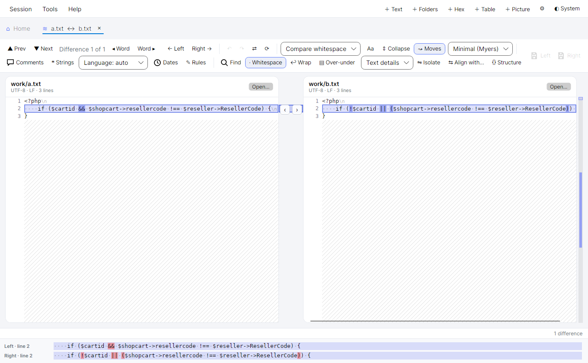

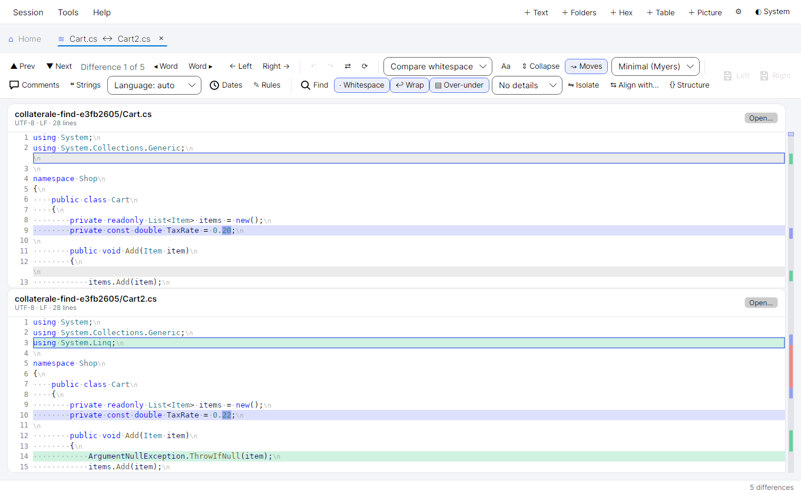

### Your choices are remembered
What you pick in the toolbar is kept for the next session, so you do not have to set it again every time: the **whitespace** setting, **Aa** (case), the algorithm, **Moves**, **Collapse**, the **ignore comments / strings / dates and times / blank lines** switches, **· Whitespace**, **↩ Wrap**, **▤ Over-under** and the **Text details / Hex details** panel. They are stored in the settings file. The **whitespace and case** decisions are shared with the three-way merge: set them in either and the other starts with them. An option given on the command line applies to that session only.

### Isolate: realign selected lines
The automatic alignment sometimes pairs the wrong lines, for example when a repeated line (`}`, a blank, a common word) exists in several places. **Isolate** lets you say "these lines belong together" or "this line has no partner":

1. **Select** the lines (in the left pane, the right pane or both). With nothing selected, the line the cursor is on is used.
2. Press **⇋ Isolate** in the toolbar, **Ctrl+Alt+I**, or right-click and choose **Isolate selected lines**.

* Lines selected on **one side only** are taken out of the matching and stand alone: the other side gets empty padding opposite them.
* Lines selected on **both sides** are compared **only with each other**, even if identical text exists elsewhere; the rows between are padded as needed.

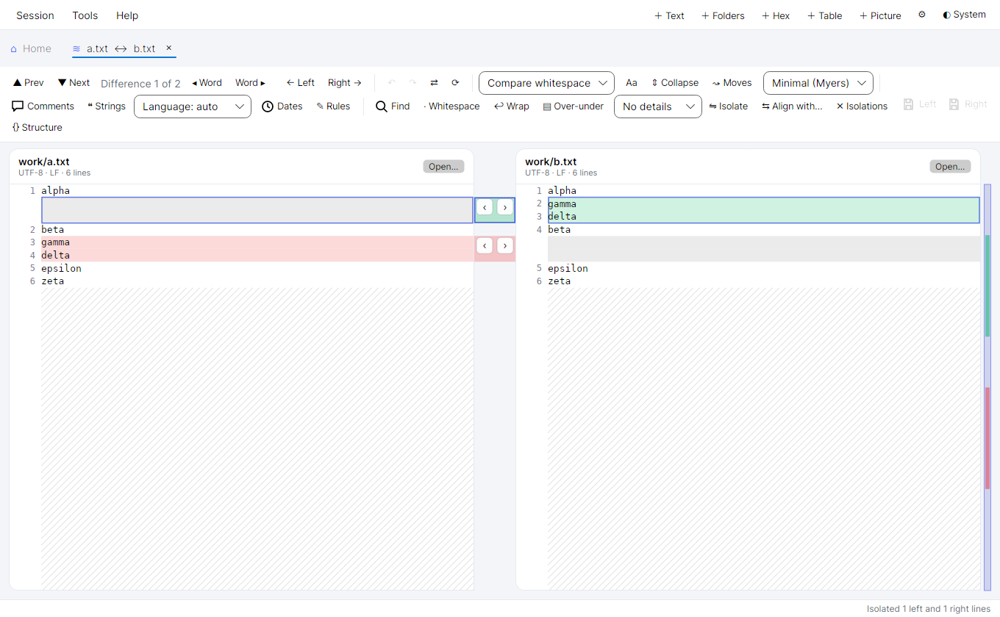

### Align with…: force two lines to face each other
When you already know which line of one file belongs opposite which line of the other, you do not need to select both:

1. Put the cursor on the line (or select it) in one pane and choose **⇆ Align with…** in the toolbar, **Ctrl+Alt+A**, or right-click ▸ **Align with…**.
2. **Click the line to align with** in the other pane. The status bar tells you what is expected; **Esc** cancels.

If you **select several lines** before choosing **Align with…**, the whole stretch is placed opposite the clicked line and the same number of lines below it, so only those lines are aligned with each other.

To undo, right-click a line and choose **Clear alignment on this line** (only the alignment holding that line goes away) or **Clear all manual alignments**.

The two lines are then isolated as a pair (see above), so they face each other and the rows between are padded. The alignment is removed with **✕ Isolations** like any isolation.

Everything around the isolated lines is compared normally, and each isolation is its own difference for navigation and copying. Isolations belong to the session: **✕ Isolations** (or the context menu's **Remove isolations**) brings back the automatic alignment. They also disappear when lines are added or removed (typing, copying a difference), because their line numbers would no longer be right. The shortcut can be changed in **Options → Commands**.

### Go to line

Press **Ctrl+G** and type a line number to jump there in both panes. The dialog applies to the pane that has the keyboard focus (the left one by default) and clamps a number beyond the end of the file to the last line. In a **collapsed** view the stretch that hides the line is opened automatically, and the caret is placed on it.

### Opening files

Use **Open…** in a pane's header to choose a file for that side, or pass two paths on the command line. The header shows the last two parts of the path (for example `v1/Cart.cs`; hover for the full path), a **●** when there are unsaved changes, the encoding, the line-ending style and the line count.

### Editing in place

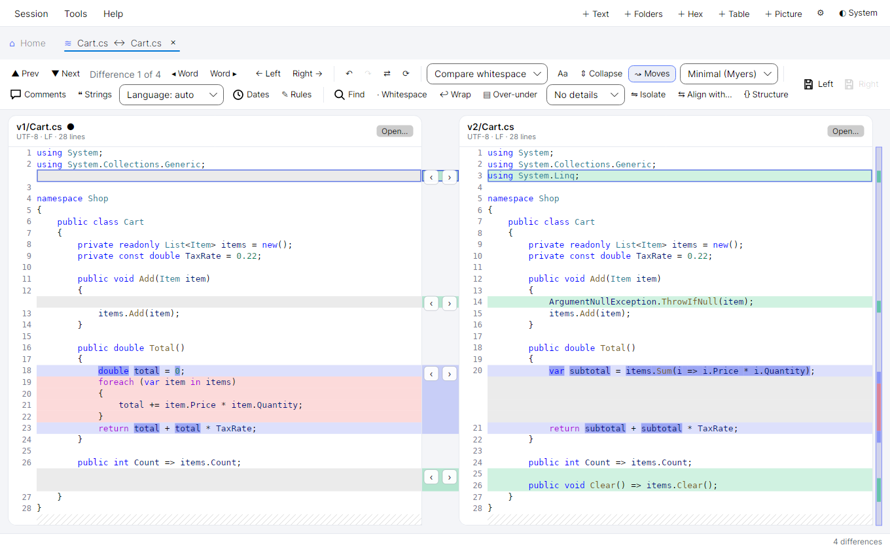

Both panes are **editable**: click in either one and type, paste or delete lines as in any editor.

* After a short pause (about half a second), or as soon as you click elsewhere, Collaterale **re-compares**: the rows realign, the colors and word highlights update, and the difference count changes. In the screenshot the `TaxRate` value was typed on the left to match the right, so that difference disappeared.
* The grey **filler rows** are not real lines. If you type into one it becomes a real line; if you leave it alone it never ends up in the saved file.
* The caret stays on the line you were editing when the view realigns.
* A **●** next to the file name marks unsaved changes, and **Left / Right** become available. Saving keeps the original encoding, BOM and line endings.
* **Undo / redo** (**Ctrl+Z** / **Ctrl+Y**, or the **↶ ↷** buttons) work on the whole file: each undo step reverts one burst of typing or one copy operation, in the order you did them, whichever pane they were in. The editor's own character-level undo is not used, because the display is rebuilt after every pause.
* **⟳** (F5) throws away unsaved edits by re-reading the files.

**When editing is disabled.** A side cannot be typed in, copied into, replaced in or saved when:

* the comparison hit an error (for example a binary file), or was cancelled;
* the file is **read-only** on disk, or sits on read-only media (a CD or DVD, a read-only archive);
* editing is disabled in the **folder session** it was opened from (*Disable editing*) — this also protects the files opened from it;
* the side was protected on the command line (`/ro`, `/ro1`, `/ro2`).

The status bar then says which, for example “🔒 Left: the left file is read-only on disk”. Patches opened from a patch file are read-only on both sides.

**Files of a folder session.** When a pair was opened from a folder session, **◂◂ File / File ▸▸** (**Ctrl+Alt+Up / Down**) open the previous or next file that differs, in the order of the folder tree; *Next difference* options choose whether that stays in the current folder and whether it wraps around.

### Saving keeps your files intact

Saving writes the file back in its **original encoding** (UTF-8, UTF-8 with BOM, UTF-16, Latin-1…), with its **original line endings** (LF, CRLF or CR) and the same **final-newline** state, so copying one block never rewrites the whole file's format.

Binary files are not shown in text compare; the status bar tells you so.

## 3. Folder compare

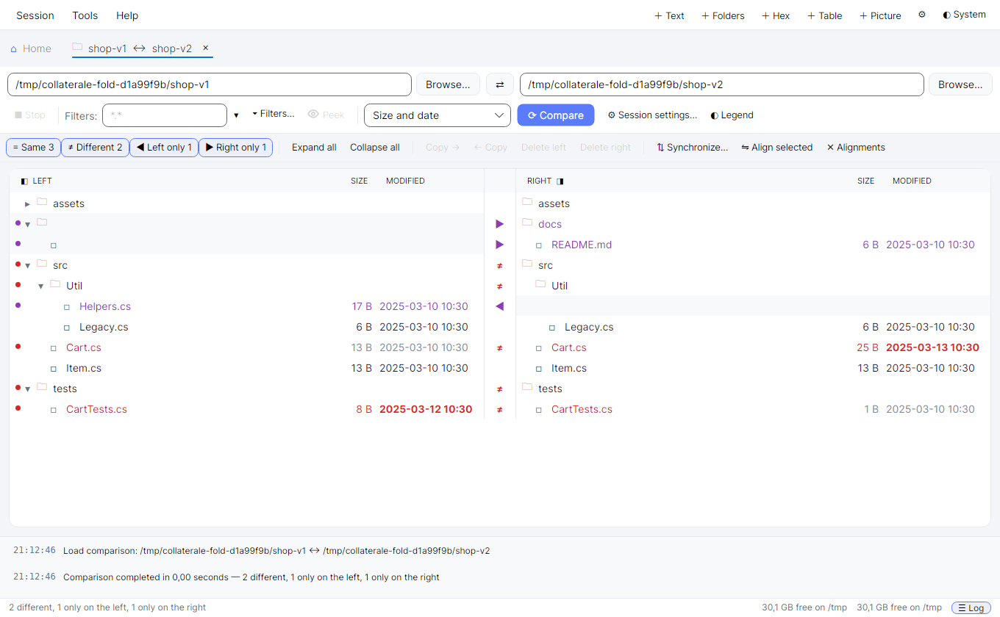

Open it from the **Folder compare** tile, **＋ Folders**, by dropping two folders on the window, or with `collaterale <folderA> <folderB>`. Type or **Browse…** the two folders and press **⟳ Compare** (it also runs by itself when you pick a folder with Browse and the other is already set).

### The toolbar

| Control | Action |
|---|---|
| **⇄ Swap** | Exchange the left and right folders (and any alignments you made) and compare again. |
| **■ Stop** | Stop a comparison that is running. |
| **Filters:** box, **▾**, **⏷ Filters…** | The box takes file masks to include (`*.cs;*.md`; empty = all). **▾** lists your saved filter presets and saves the current filters as a new one. **⏷ Filters…** opens the full set of name and other filters. |
| **Peek** (**Space**) | A quick, read-only look at the selected file: the differences between a pair of text files, the start of a file that exists on one side only, or the counts inside a folder. Binary files say so. |
| **Criterion list** | *Size and date* (default), *Size only*, *Contents only*, or *Size and date, then contents* — see *Comparison settings* below. |
| **⚙ Session settings…** | Everything that decides what is compared and how. |
| **◐ Legend** | What the colors and symbols mean, in the colors you are actually using. |
| **= / ≠ / ◀ / ▶ chips** | Count and filter files by state: click one to hide or show that kind. |
| **Expand all / Collapse all**, **Copy**, **Delete**, **⇅ Synchronize…** | See *Copying and deleting* and *Synchronize*. |
| **⇋ Align selected**, **✕ Alignments** | Compare two items although their names differ — see *Alignment*. |

### Reading the tree

Colors follow one simple scheme; each row also has a small **color spot** before its name that stays visible while the row is selected.

| Color | Meaning |
|---|---|
| **Gray** | The **older** copy of a file that differs, and folders whose contents are identical. |
| **Normal text** | Same on both sides. |
| **Purple** | An **orphan**: it exists on one side only. A folder is purple when it contains orphans (and nothing that merely differs). |
| **Red** | The **newer** copy, or a file that differs in another way. A folder is red when something below it differs. |
| **Teal** | A file hidden by an *other filter* that is shown only because its counterpart on the other side is not hidden. |

The **center column** shows the result for the row: **=** same, **≠** different, **◀** only on the left, **▶** only on the right, **⇄** renamed or moved, **⚠** a file on one side and a folder on the other, or something that could not be read. A **bold date** marks the newer side. **▤** marks an archive. If two items were lined up although their names differ, the row shows both names: `report.doc ↔ report.pdf`.

Folders that contain differences start **expanded** by default (you can change that: *Handling → Folders*). Click **▸/▾** or press **→ / ←** to expand or collapse; **Double-click** or **Enter** expands a folder, and on a file that exists on both sides opens the pair in the view that suits it (text, table, hex or picture).

**Folder sizes.** A folder row shows the **total size** of the files below it on each side (after filtering), including folders that exist on one side only.

**Right-click a row** for a menu: open the pair, peek, copy to either side, delete, align, show the left or right item in the system file manager, and copy the full paths to the clipboard.

**Two panes, side by side.** The left folder is on the left and the right folder on the right, with the state symbol (`=`, `≠`, `◀`, `▶`) between them. Every row has the same height in both panes, so an item can be followed across; where a side has no counterpart, its slot stays empty and softly tinted. The swap button `⇄` sits between the two path boxes.

**Columns.** Click a column title (**LEFT**, **RIGHT**, and **SIZE** / **MODIFIED** of each pane) to sort by it; click again to reverse. Folders always stay before files. **Right-click the header** to show or hide the sizes, the dates, and the **WHY** column, which says in words what differs for each file: *size, time, content, attributes, permissions, name case, version*.

**Messages.** The strip under the tree is a **log** with a time stamp for every step ("Load comparison…", "Comparison completed in 0.43 seconds — 2 different…"); **☰ Log** hides it. The status bar shows the summary, the number of selected rows and the **free space** of each side's disk.

### Session settings

**⚙ Session settings…** opens one window with seven tabs. Nothing changes until you press **OK**, which compares again with the new rules. **Use as defaults for new sessions** keeps the settings (except the folders, the description and the alignments) for every new folder comparison.

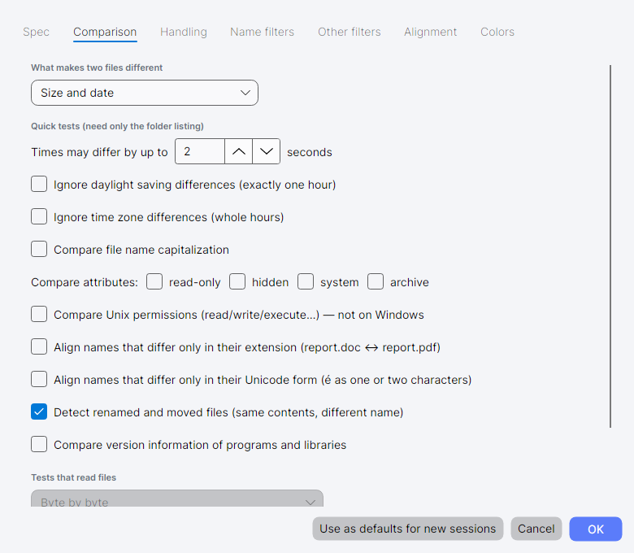

**Spec.** Shows the two folders, a free-text **Description** (it becomes the tab's tooltip), and **Disable editing**, which protects your files: copy, delete and synchronize are refused, and text files opened from this session cannot be edited, copied between sides or saved.

**Comparison.** What makes two files different.

| Setting | Meaning |
|---|---|
| **Criterion** | *Size and date*: equal when size and time match. *Size only*. *Contents only*: equal when the contents match, ignoring time (sizes are checked first, so most differences are instant). *Size and date, then contents*: files with the same size and time are the same **without being read**; the others are read and, if their contents match, are still reported as the same. |
| **Times may differ by up to N seconds** | Tolerance for coarse file systems (FAT keeps 2-second resolution). Default 2. |
| **Ignore daylight saving differences** | A time difference of exactly one hour (either way) does not count. |
| **Ignore time zone differences** | Differences of a whole number of hours do not count; minutes and seconds still do. |
| **Compare file name capitalization** | `Readme.TXT` and `readme.txt` are paired (on Windows and macOS) but reported as different. |
| **Compare attributes** | Read-only, hidden, system, archive must match. Off by default, because copying a file changes its archive bit. |
| **Compare Unix permissions** | Mode bits (read/write/execute/sticky) must match. Not on Windows. Owner and group IDs are not compared. |
| **Align different extensions** | `report.doc` is lined up with `report.pdf` when each is the only candidate (see *Alignment*). |
| **Align Unicode forms** | `é` as one character is lined up with `e` + accent. |
| **Detect renamed and moved files** | See *Renamed and moved files*. |
| **Compare version information** | Programs and libraries with different versions differ even if size and time match. Works for .NET assemblies everywhere and for any executable on Windows; files without version information are unaffected. |

Tests that read files (used by the *contents* criteria):

| Setting | Meaning |
|---|---|
| **Byte by byte** | Stops at the first difference. |
| **Checksum (CRC-32)** | Sums each whole file and compares the sums. Fast; good against accidental changes. |
| **Checksum (SHA-1)** / **Checksum (SHA-256)** | Hashes each whole file with a cryptographic hash and compares the hashes. Much stronger than CRC-32 — a different file all but never has the same hash — so use them to **verify copies and backups** (for example after a transfer, or to find files that were silently corrupted). SHA-256 is the strongest and a little slower. Both files are read in full. |
| **As text, with rules** | Compares text files **as text**: line endings and the text encoding never matter, and you can also ignore *whitespace* (amount, leading/trailing, all), *case*, *comments* and *what string literals say* (language from the file name), *dates and times*, and *blank lines* — the same rules as the text compare. A file that is not text is compared byte by byte, and size is not used as a shortcut (a CRLF and an LF copy have different sizes). |
| **Skip the content test when the quick tests say the files are the same** / **Override quick test results** | For *Size and date, then contents*: the first leaves matching files unread (fast); the second makes files with equal contents "same" even if their time or attributes differ. |

**Handling.**

| Setting | Meaning |
|---|---|
| **Scan subfolders**, **Hide empty folders** | Whether to go below the top level, and whether folders left empty by the filters disappear. |
| **Expand** | *Only folders with differences* (default), *all folders*, or *keep collapsed* when a comparison is loaded. |
| **Archives** | *As files* (default), *as folders once opened* (an archive is a file until you double-click it, then its contents are compared), or *as folders, always* (every archive is unpacked up front; slower). Zip, jar, war, nupkg, tar, tar.gz and tgz are understood. |
| **Follow symbolic links** | Off (default): a link is one entry, equal to another link with the same target, and is never entered. On: it is shown as its target (files or folders, with the target's size and date); link cycles are detected and not followed twice. |
| **Compare again every N seconds** | Automatic refresh (0 = never); the expansion state is kept. |

**Name filters.** File masks (`*` any characters, `?` one character, several separated by `;`): **Include files**, **Exclude files**, **Include folders** (when set, only matching folders are entered, at any depth) and **Exclude folders** (default `.git;.svn;.hg;node_modules`). **Clear all** empties them. **Presets**: type a name and press **Add to presets** to save the four masks; pick one from the list to load it; **Remove selected** deletes it. Presets are also available from the **▾** next to the Filters box.

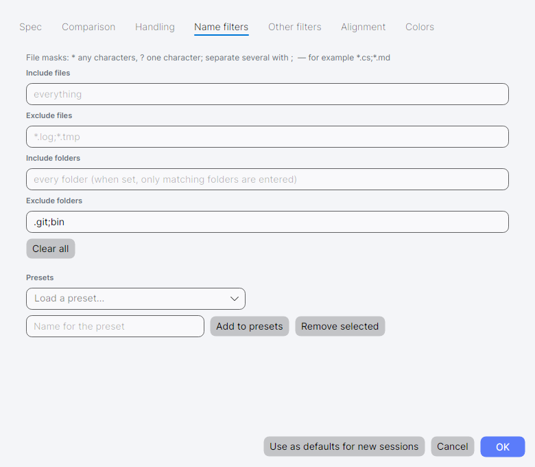

**Other filters.** Hide files by something other than their name. A file matching **any** rule is hidden: smaller or larger than a size, modified before or after a date, modified or not modified within the last N days, or read-only/hidden/system. **Exclude protected operating system files** (on by default) hides `.DS_Store`, `._*` droppings, `Thumbs.db`, `desktop.ini` and hidden system files. If a rule hides a file on one side but **not** its counterpart on the other, both stay visible — so the pair is not mistaken for an orphan — and the hidden one is shown in **teal**.

**Alignment.** Lists the pairs you made by hand, each with a **Remove** button.

**Colors.** The five colors of the tree as `#RRGGBB`; empty means the theme's own color (which differs between light and dark). They apply to every session.

### Alignment

Files and folders are lined up **by name**. To compare two items whose names differ, select **one that exists only on the left and one that exists only on the right, in the same folder**, and press **⇋ Align selected**; they become one row and are compared with each other. **✕ Alignments** removes the pairs you made. Two settings align automatically, only when each side has exactly one candidate and never in preference to an identical name: *Align different extensions* and *Align Unicode forms*. When you copy an aligned pair, the other side's **own file name is kept** (the left `report.doc` overwrites the right `report.pdf`; no stray copy appears).

### Renamed and moved files

A file that exists on one side only, under a name for which the other side has an identical-content file with a different name, is shown as **⇄** on both rows. Detection compares same-size files only, so it stays fast; if several identical copies exist it prefers the one with the same file name or the longest matching folder path. The two **Mirror** modes apply a detected rename as a **rename** on the destination instead of copying and deleting. A file that was renamed *and* edited shows as one deletion plus one addition.

### Archives

With *Archives → as folders*, an archive row (**▤**) behaves like a folder: expand it to see what changed inside. Files inside an archive are **temporary unpacked copies**: you can compare them, peek at them and open them in a text/hex/picture compare, but they are never synchronized or deleted — only the archive file itself is. Entries whose path would leave the target folder ("zip-slip") are ignored, links and devices inside tar files are skipped, and an archive that cannot be read is simply compared as a file. The unpacked copies are deleted when you quit.

Give Collaterale **two archives** directly (`collaterale a.zip b.zip`, dropping them on the window, or the recent list) and it compares their contents as two folders.

### Copying and deleting

Select rows (click, **Shift+click** for a range, **Ctrl+click** to add) and use:

* **Copy →** / **← Copy** — copy the selection to the other side. Selecting a folder copies everything below it. Files you copy keep their modification time, so they show as **same** afterwards. Read-only destination files are overwritten.
* **Delete left** / **Delete right** — remove the selection from that side.

Both show a confirmation listing **every step** first. Deleting is permanent (nothing goes to the recycle bin). Afterwards the folders are re-compared automatically. None of this works while **Disable editing** is on.

### Synchronize

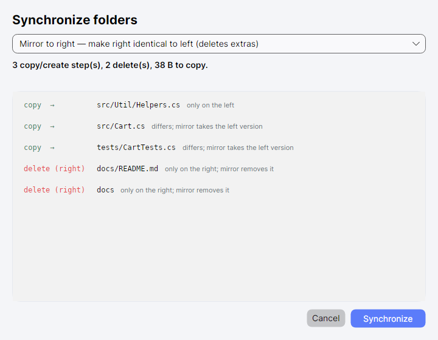

**⇅ Synchronize…** plans a whole-folder operation and shows the result **before** anything is touched. Choose a mode:

| Mode | What it does |
|---|---|
| **Update right** | Copies new and newer files from left to right. Never deletes. |
| **Update left** | The same in the other direction. |
| **Mirror to right** | Makes the right folder identical to the left: copies new and changed files and **deletes** what exists only on the right. |
| **Mirror to left** | The reverse. |
| **Two-way** | Sends the **newer** version of each file to the other side and copies one-sided files both ways. Never deletes. |

The two **Mirror** modes apply a detected rename as a **rename** on the destination (`rename →` in the preview) instead of copying the file again and deleting the old one. Update and Two-way treat the new name as a new file (Two-way leaves it alone and says so, because it cannot know which name is right).

The preview lists each step (folders are created first, deletions come last and are shown in red) with the reason, the amount of data to copy and the number of deletions. Files the plan deliberately leaves alone are counted and explained — for example a file that differs but has the *same* modification time, where Collaterale cannot tell which side is right. Nothing happens until you press **Synchronize**; **Esc** or Cancel changes nothing.

## 4. Three-way merge

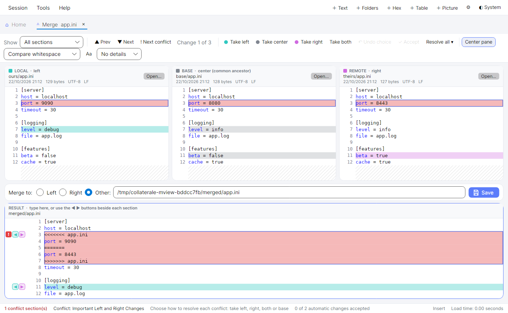

A three-way merge combines two edited versions of a file (**left** and **right**) using the file they both started from (the **base**, or common ancestor). Changes made on only one side are applied automatically; places where both sides changed the same lines differently are **conflicts** that you decide.

Start one from the **Three-way merge** tile (then use **Open…** on each pane to choose the left, right and — optionally — base files), from `collaterale --merge --base B --left L --right R --output O`, or from `git mergetool` ([section 1c](#1c-command-line-and-git-integration)). Without a base file the two sides are merged against an empty file, so any lines they do not both contain will conflict.

### How a three-way merge decides

With only two versions, an item that exists on one side and not the other is ambiguous: it may have been **added** there, or **deleted** from the other side. The base — the older copy both sides started from — settles it. A line present in the base and gone on one side was deleted there; a line absent from the base and present on one side was added there. Changes made on one side only are taken automatically.

Not every change can be merged safely. When the **same lines** were changed on both sides, and the two changes **differ**, the place is a **conflict** and needs your decision. When both sides made the **same** change, it is not a conflict.

### The layout

* **Top: Local (left) | Base (center) | Remote (right).** The three versions side by side — in a git merge, *Local* is your branch (`$LOCAL`), *Remote* is the branch being merged in (`$REMOTE`) and *Base* is their common ancestor (`$BASE`) — kept level so the same region sits at the same height in all three; where a version has no lines for a region it shows a hatched slot. Each header has a color mark (teal, grey, magenta), the path, and the file's date, size, encoding and line endings. **Center pane** hides the middle pane.
* **Middle: Merge to.** Choose where **Save** writes: the **Left** file, the **Right** file, or **Other** (a path you type; the default for command-line merges).
* **Bottom: Result.** The merged text, which is what will be saved. It starts as the automatic merge, and you can **type in it directly** at any time. Beside each changed section there are small buttons: **◀** takes the left version, **▶** the right version, and a red **!** marks a conflict that is still open.
* **Status bar.** The number of conflict sections left, what kind of section the cursor is on (*Important Left Change*, *Important Right Change*, *Conflict*…), and how long the load took.

### Colors

| Color | Meaning |
|---|---|
| Teal | A change made on the **left**. In the result: text that came from the left. |
| Magenta | A change made on the **right**. In the result: text that came from the right. |
| Red | A **conflict**: both sides changed it differently. In the result it appears as git-style markers (`<<<<<<<`, `=======`, `>>>>>>>`) until you decide. |
| Grey | The base's version of a section that changed. |
| Hatched | A version has no lines here (the other side added or deleted them). |
| Blue outline | The **current change**, the one the toolbar acts on (outlined in all four panes). |

### Display filters

The **Show** list limits the three input panes to some sections; the others fold into one line ("12 lines hidden by the filter — click to show"), and a click on it opens that section again. *Differences* hides unchanged text, *Same* shows only unchanged text, *Conflicts* only conflicts, *Left changes* / *Right changes* only sections that one side changed, and *Same on both sides* those where both made the identical change.

The merge remembers the **Show** filter, **Center pane**, the whitespace setting and **Aa** for the next merge (the last two are shared with the text compare, see [Your choices are remembered](#your-choices-are-remembered)).

### Resolving

| Control | Action |
|---|---|
| **▲ Prev / ▼ Next** | Step through all changes (conflicting or not). The text shows "Change 2 of 3". |
| **! Next conflict** (**F8**) | Jump to the next conflict that still has no decision. |
| **Take left** (**Alt+Left**) / **Take right** (**Alt+Right**) | Use that side's version for the current change. |
| **Take center** | Use the base's version: discard both sides' edits for this change. |
| **Take both** | The left lines followed by the right lines. |
| **◀ / ▶ beside the result** | The same, for the section next to the button. |
| **↶ Undo choice** | Take back your choice for the current section: it returns to the automatic result, or to an open conflict. |
| **✓ Accept** | Mark the current **automatic** change (one side changed it, or both changed it the same way) as reviewed, and go to the next section that still has no decision. The result does not change; the status bar counts "2 of 5 automatic changes accepted". Not available on a conflict, which needs a real choice. |
| **Resolve all ▾** | Settle many sections at once: **every open conflict → take left / right / both / center**; **Accept every automatic change**; **Undo every choice** (back to the automatic merge with conflicts open). Conflicts you already decided are never touched by the *every open conflict* entries. |
| **Text details** | A panel under the panes with the **current line in full** for the left, base and right versions (the row where the cursor is in the top panes) and for the **result**. Handy for long lines that the panes cut off. The panel is read-only (type in the result pane); its on/off state is remembered. |
| **Whitespace / Aa** | Ignore whitespace or case differences while merging, so a re-indented line does not conflict with a real edit. |

After you resolve a conflict Collaterale moves on to the next unresolved one, and the status bar counts what is left. You can also take a side for a **non-conflicting** change to override the automatic result (for example, reject one side's edit with *Take center*).

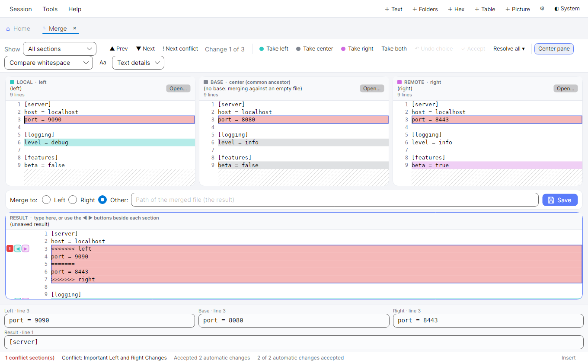

### Editing the result by hand

Click in the **Result** pane and type. As soon as you do, the colored regions disappear, the resolve buttons turn off (they would overwrite your typing) and a **↺ Reset** button appears next to **Save**; use it to go back to the automatic merge and your choices.

### Saving

**Save** (**Ctrl+S**) writes the result to the file chosen under *Merge to* (you are asked for a name if there is none). The file keeps the **encoding, BOM and line endings** of the inputs.

If conflicts are still unresolved, Collaterale refuses by default; you can choose **Save with markers**, which writes the conflict markers into the file so you can finish elsewhere.

**Exit code for git:** when started from the command line, Collaterale exits with **0** only after the result was saved with no conflicts left; closing the window, or saving with markers, exits with **1**, so `git mergetool` correctly keeps the file marked as unmerged.

## 5. Hex compare

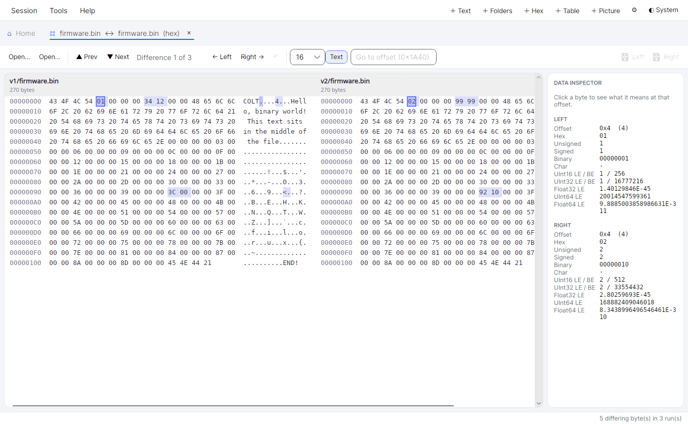

Hex compare shows two **binary** files byte by byte. Open it from the **Hex compare** tile, **＋ Hex**, with `collaterale --hex fileA fileB`, or by choosing files with the **Open…** buttons.

### Reading the view

Each side is a classic hex dump: the **offset** (position in the file) on the left, then the bytes in hexadecimal, then the same bytes as **text** (non-printable bytes show as `.`). Files are compared **position by position**: byte *n* of the left file against byte *n* of the right.

| Color | Meaning |
|---|---|
| Blue | The byte is different on the two sides. |
| Red / green | The file continues here but the other file has already ended (red on the left, green on the right). |
| Grey blank | This file has ended; the other one still has bytes here. |
| Blue outline | The **current difference** (a run of consecutive differing bytes). |
| Light blue box | The **selected byte** (click a byte, or use the arrow keys). |

The status bar says how many bytes differ and in how many runs. Very large comparisons are limited to the first 200,000 runs (a "+" is shown after the count).

### Toolbar

| Control | Action |
|---|---|
| **Open…** (twice) | Choose the left and right file. |
| **▲ Prev / ▼ Next** (**Alt+Up / Alt+Down**, **F8**) | Previous / next difference; the view scrolls to it. |
| **← Left / Right →** (**Alt+Left / Alt+Right**) | Overwrite the current difference on that side with the other side's bytes. Where only one file has data, copying extends or shortens the target so the two files end up identical. |
| **↶** (**Ctrl+Z**) | Undo the last copy (exactly, including a length change). |
| **8 / 16 / 24 / 32** | Bytes per row. |
| **Text** | Show or hide the character column. |
| **Go to offset** | Type an offset and press **Enter**: `0x1A40`, `1A40h` or a decimal number like `6720`. |
| **Left / Right** | Save that file (enabled after you copy something into it). |

You can also scroll with the wheel or the scroll bar, move the selection with the **arrow keys**, **Page Up / Page Down**, **Home / End** (and **Ctrl+Home / Ctrl+End** for the whole file).

### Data inspector

The panel on the right explains the **selected byte** on each side: its hex, unsigned/signed and binary values, the character, and — where enough bytes follow — the 16-, 32- and 64-bit integers (little- and big-endian) and the 32/64-bit floating point values. It makes it easy to see what a changed byte *means* (a counter, a flag, a length…).

### Notes

* Both files are held in memory; files over **512 MB** are refused with a message.
* Because comparison is by position, inserting a byte near the start of a file shifts everything after it and shows up as many differences. Use a text compare for text files, where lines are aligned.

## 6. Table compare

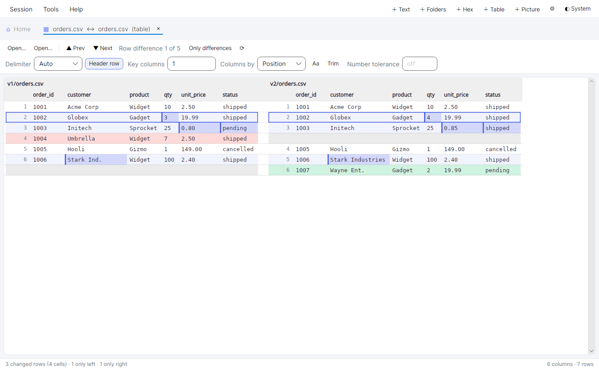

Table compare reads **CSV, TSV and similar delimited files** and compares them **cell by cell**, so a change in one value shows as one highlighted cell instead of a whole changed line. Open it from the **Table compare** tile, **＋ Table**, with `collaterale --table fileA fileB`, or with the **Open…** buttons.

### Reading the view

The two tables sit side by side with shared column widths; the header row (column names) stays visible at the top.

| Look | Meaning |
|---|---|
| Blue cell with a bar on its left edge | The value differs between the two sides. |
| Faint blue row | A row that has at least one different cell. |
| Red row with a grey filler opposite | A row that exists only on the **left** (removed). |
| Green row with a grey filler opposite | A row that exists only on the **right** (added). |
| Grey column cells | The column exists on one side only (see *Columns by header* below). |
| Blue outline | The **current** differing row. |

Cells with line breaks are shown on one line with a `↵` mark. The status bar summarizes "3 changed rows (4 cells) · 1 only left · 1 only right".

### Matching rows

* **No key columns (default):** rows are aligned by their **content**, like a text compare: inserted and deleted rows are found, and a row whose values changed is paired with its old version when the rows look alike.
* **Key columns:** type the column(s) that identify a row — for example `1`, `A` or `order_id`; several are separated by commas (`1,3`). Rows are then matched by **key**, regardless of order: a re-sorted export compares as identical, and only real differences remain. Rows whose key exists on one side only are shown as removed/added; if a key occurs several times, the occurrences are matched in order.

### Options

| Option | Meaning |
|---|---|
| **Delimiter** | *Auto* (default) detects comma, semicolon, tab or pipe for each file separately by choosing the one that gives the most consistent column count (so `"Widget, large";9,50` is not split on its commas). Choose one explicitly to force it for both files. |
| **Header row** | The first row holds column names (on by default). Turn it off to compare every row as data; columns are then named A, B, C… |
| **Key columns** | See above. |
| **Columns by** | *Position*: column *n* is compared with column *n*, and a column one side lacks counts as blank cells. *Header*: columns are paired by their header text, so reordered columns still line up; a column only one side has is shown greyed and reported as a structural difference without marking every row as changed. |
| **Aa** | Ignore letter case in cells. |
| **Trim** | Ignore spaces at the start and end of cells. |
| **Number tolerance** | Cells that both contain numbers are equal if they differ by at most this amount. `0` means "same value" (`100.0` equals `100`); `0.001` accepts tiny rounding differences. Leave it empty to compare the text exactly. |
| **Only differences** | Hide rows that are the same. |
| **▲ Prev / ▼ Next** (**Alt+Up / Alt+Down**, **F8**) | Jump between differing rows (wraps around). |
| **⟳** (**F5**) | Reload both files. |

Quoted fields (`"a, b"`), doubled quotes (`""`) and line breaks inside quotes are handled according to RFC 4180. Tables with hundreds of thousands of rows scroll smoothly because only the visible rows are drawn.

## 7. Picture compare

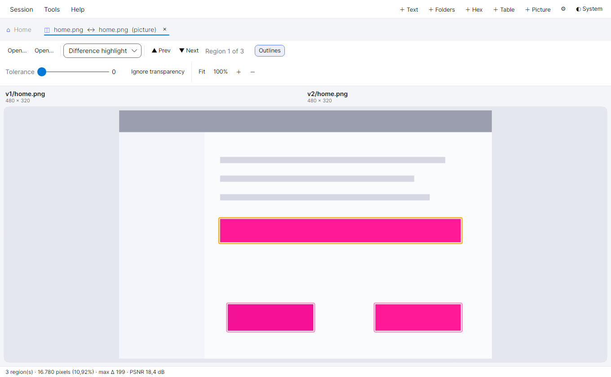

Picture compare shows exactly **which pixels differ** between two images — handy for screenshots, designs, renders and test baselines. It reads **PNG, JPEG, GIF, BMP, WebP and ICO**. Open it from the **Picture compare** tile, **＋ Picture**, with `collaterale --image fileA fileB`, or with the **Open…** buttons.

### What is found

Every pixel is compared (all four channels, or just the colors with *Ignore transparency*). Pixels that differ are grouped into **regions** — boxes drawn around each cluster of changes, outlined in pink, with the current one in amber. The status bar reports the number of regions, the number and percentage of different pixels, the **largest color difference** (0–255 in any channel) and the **PSNR** (a similarity score in dB: higher means more alike). If the two pictures have different dimensions, the extra area counts as different and the status bar says so.

### Viewing modes

Choose the mode in the drop-down:

| Mode | What you see |
|---|---|
| **Difference highlight** (default) | The left picture faded, with the differing pixels in solid magenta. The quickest way to see *where* things changed. |
| **Side by side** | Both pictures next to each other, panned and zoomed together. |
| **Overlay (blend)** | The right picture drawn over the left; the **Opacity** slider fades between them. |
| **Swipe (curtain)** | A vertical divider: the left picture on one side, the right on the other. **Drag the round handle** (or anywhere near the line) to sweep across and compare the same spot. |

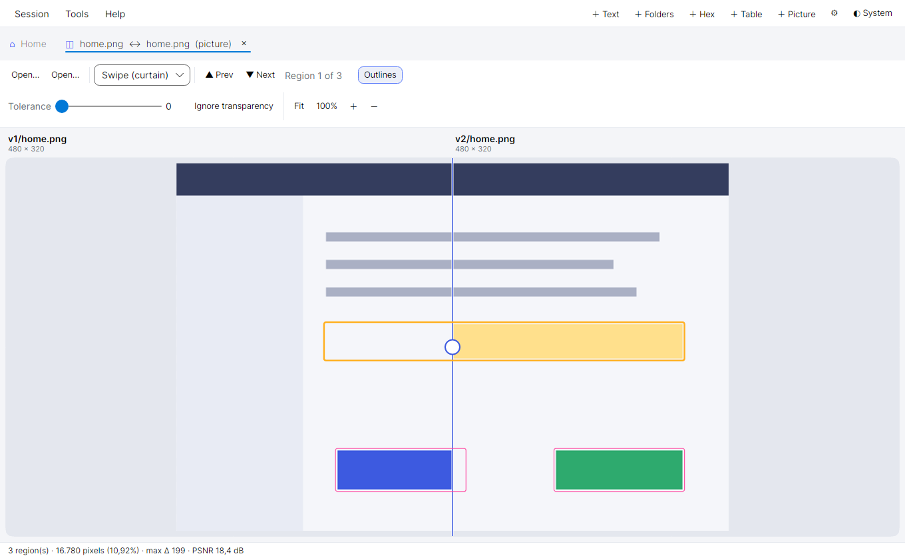

### Zoom and pan

Scroll the **mouse wheel** to zoom around the pointer, and **drag** to pan. **Fit** fits the picture to the window, **100%** shows actual pixels, and **＋ / －** zoom in steps. When zoomed in past 200% pixels are drawn as crisp squares instead of being smoothed. While you hover, the status bar shows the pixel's coordinates, its color in **both** pictures (hex, with the alpha when not opaque) and a **≠** if they differ.

### Options

| Option | Meaning |
|---|---|
| **Tolerance** | Color differences up to this size (0–255 per channel) are ignored. Use a small value (2–8) to look past JPEG compression noise or anti-aliasing while still catching real changes. `0` is an exact comparison. |
| **Ignore transparency** | Compare only the colors, not the alpha channel. |
| **Outlines** | Show or hide the boxes around changed regions. |
| **▲ Prev / ▼ Next** (**Alt+Up / Alt+Down**, **F8**) | Step through the changed regions; when you are zoomed in the view moves to each one. |
| **F5** | Reload both pictures from disk. |

Pictures larger than 150 million pixels are refused with a message.

## 8. Themes

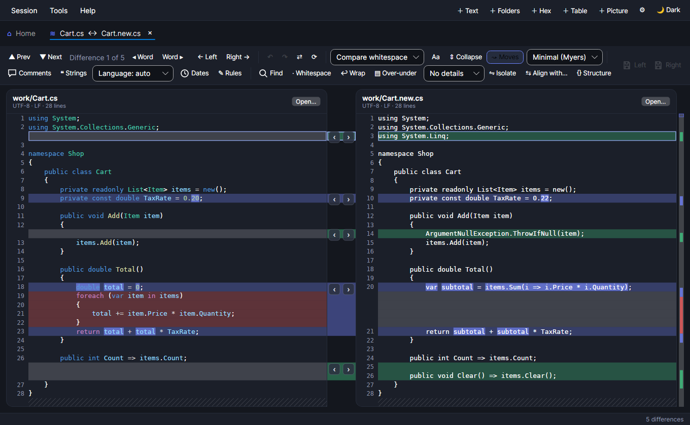

The button at the top right cycles **System** (follows your operating system), **Light** and **Dark**. The choice is remembered. All comparison colors are tuned separately for each theme.

## 8b. Options

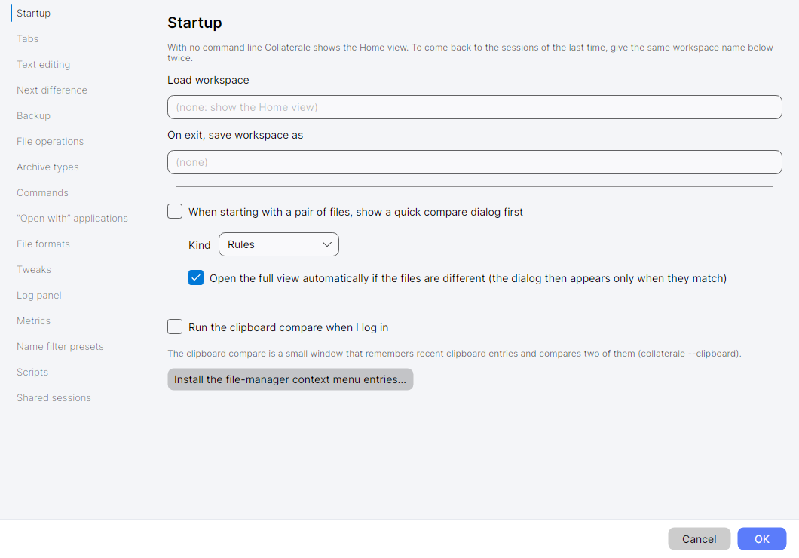

**Tools ▸ Options** (the **⚙** button) opens one window with a page for each group of settings. It works on a copy: **OK** applies and saves everything, **Cancel** changes nothing. Changes take effect at once in the sessions that are open.

| Page | What it controls |
|---|---|
| **Startup** | A workspace to open when the program starts with no command line, and one to save when it closes (give the same name to both to come back to where you left off). An optional **quick compare dialog** before a pair of files given on the command line: *Binary* (byte by byte) or *Rules* (the text rules); with **Open the full view automatically if the files are different** the dialog only appears when they match. **Run the clipboard compare when I log in** (see *The clipboard*). A button installs the file-manager context-menu entries. |
| **Tabs** | Whether a new session, and a file session opened from a folder session, open in a **tab** or a **window**; closing the last tab closes the window; hiding the tab bar when there is one tab. With both off, closing the last tab returns to the Home view. |
| **Text editing** | *Auto indent* (a new line starts at the previous indentation); *Backspace unindents* (in leading spaces it goes back one tab stop); *Initialize “Text to find” to the current word*; *show how many lines the display filters hide* (the status bar of a folded compare); the **context lines** kept around a difference when unchanged text is folded; the tab width. |
| **Next difference** | Go to the first difference when files load; go to the next one after copying; wrap around at the end; show a message when there is nowhere to go. |
| **Backup** | Keep a copy of a file before it is overwritten by a copy, a move, a synchronize or a save. *SameFolderSuffix* (`name.txt.bak`), *SameFolderNumbered* (`name.txt.bak1`, `.bak2`…), *SameFolderTimestamp* (`name.txt.20260131-142530.bak`) or *BackupFolder* (one folder of your choice, keeping the layout). **Versions to keep** deletes the oldest numbered or time-stamped copies. **Off by default**, because a backup next to the file shows up as an extra file the next time the same folders are compared. `/nobackups` turns it off for one run. |
| **File operations** | Which actions ask for confirmation (copy, move, delete, overwrite). **Synchronize confirmations**: *Prompt*, *Yes to all* (go ahead after the preview) or *No to all* (the command is turned off). |
| **Archive types** | The file masks that make a file an archive Collaterale can browse as a folder, per format. Clear a mask to drop a format. |
| **Commands** | Every command with its keyboard shortcut. Click the box and press the keys; **Remove** clears it, **Default** restores it. If the shortcut is used by another command you are asked whether to take it over. The search box filters by name or description. Shortcuts can be changed for the Text compare, Three-way merge and Folder compare views. |
| **“Open with” applications** | Programs for the **Open with** submenu of the folder view's context menu. In the arguments `%1` is the file and `%2` the file on the other side. |
| **File formats** | Your own file types: see [Your own file formats](#your-own-file-formats). |
| **Tweaks** | *Updates* (see below); *editor display* (syntax colors on difference lines, hatching beyond the end of the text, a separate color for one-sided lines, dimming the pane that is not active, a font for the merge input panes, a column line at a chosen column); *file operations* (beep after a long operation, remove the read-only flag when copying from a CD or DVD, check for files changed on disk and reload them, comparison priority, buffer size of the binary compare); *interface* (hints on or off, Esc closes file views, sticky splitter and sticky Home tile). |
| **Log panel** | Which messages the log of a folder session shows (summaries, details, warnings, debug), how many it keeps, and a file to append them to. |
| **Metrics** | The number of automatically saved workspaces (0 turns the feature off), of recent items, the delay before a hint appears, and how long the type-ahead search waits before starting over. |
| **Name filter presets** | The ready-made name filters of the folder view toolbar. |
| **Scripts** | Beep and close when a script has finished; a shared folder for scripts. |
| **Shared sessions** | A file of sessions from someone else; they appear next to yours and can be used but not changed. |

### Your own file formats

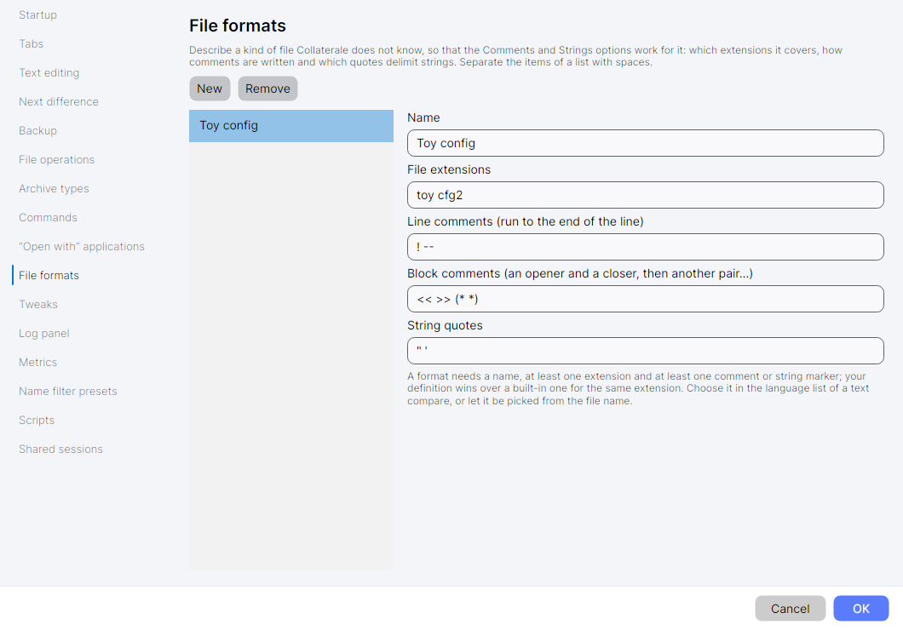

Comments and strings are recognised for the languages Collaterale knows (see [Smart rules](#smart-rules-what-counts-as-a-difference)). For anything else — a configuration language, an in-house format, a script dialect — describe it under **Options ▸ File formats** and the **Comments** and **❝ Strings** switches work for it too. Press **New**, then fill in:

| Field | Meaning |
|---|---|
| **Name** | What the language list shows. |
| **File extensions** | Which files it covers, with or without the dot, separated by spaces: `toy cfg2`. |
| **Line comments** | Markers that start a comment running to the end of the line: `# //`. A semicolon is fine here (`;`) — lists are separated by spaces. |
| **Block comments** | An opener and a closer, then the next pair: `/* */ <!-- -->` is two styles. A comment may span lines. |
| **String quotes** | The characters that open and close a string literal, with backslash escapes inside: `" '`. A comment marker inside a string is not a comment. |

A format needs a name, at least one extension and at least one marker; an incomplete one is dropped when you press **OK**. Your definition **wins over a built-in one** for the same extension (handy to change how `.conf` files are read). The new language appears in the language list next to **Comments** at once, and is picked automatically from the file name. Formats are stored with your other options and travel in a settings package.

**Updates.** With *Check for updates* on and the address of a small JSON file (`{"version": "1.2.3", "url": "https://…"}`) set, Collaterale asks it at most every *n* days and tells you when a newer version exists. With no address nothing is ever sent.

**Checking files on disk.** When you return to a text compare and one of its files was changed by another program, Collaterale asks “Reload?” once per change. With *reload automatically* it reloads by itself, but never when that would throw away your unsaved edits.

**Walking through the differences.** **▲ Prev / ▼ Next** go section by section (**Alt+Down / Alt+Up**, **F8 / Shift+F8**); **◂ Word / Word ▸** (**F7 / Shift+F7**) go to each *individual* changed word, which matters in a long line with several changes. In a folder session, type the first letters of a name to jump to it.

## 8c. Sessions, workspaces, scripts and settings packages


* **Session** — a comparison saved under a name. **Session ▸ Save session as…** saves the tab in front; it appears on the Home view and opens with `collaterale "name"`.
* **Workspace** — everything that is open. **Session ▸ Save workspace as…** saves all the tabs and which one was in front; **Load workspace…** brings them back (a session whose files are gone is skipped with a message). When the program closes it also keeps a snapshot of what was open (the *Max auto-saved sessions* metric says how many are kept).
* **Shared sessions** — **Tools ▸ Export sessions…** writes your sessions to a file; set it as *Shared sessions file* on another machine.
* **Settings packages** — **Tools ▸ Export settings…** writes the options, colors, filter presets, sessions and workspaces to a `.cpkg` file (never the list of files you opened); **Import settings…**, or `collaterale file.cpkg`, applies one. `collaterale /silent file.cpkg` imports with no window.
* **Scripts** — `collaterale @script.txt` (or **Tools ▸ Run script…**) runs a script. Commands, one per line, `#` for comments, quotes around text with spaces:

```
load "left folder" "right folder"        compare two folders; what follows uses this comparison
filter "*.cs;*.md"                        only these files
criteria size | time | sizetime | content how files are judged different
select all | diffs | same | left-only | right-only | newer-left | newer-right | none
copy left->right | right->left            copy the selection
delete left | right                       delete the selection from that side
sync mirror|update left->right|right->left      or:  sync two-way
report "file.txt"                         write the differences to a text file
diff "a.txt" "b.txt"                      print a unified diff
include "other.txt"                       run another script here
log "message"                             print a message
exit N                                    stop with that exit code
```

The whole script is checked before anything is done, so a typo late in the file never leaves a half-done job. Exit codes: **0** done, **105** the script could not be loaded, **106** a syntax error (the message names the line), **107** a command failed. A script name that is not found in the current folder is looked for in the shared scripts folder.

## 8d. Text edit, patches and the clipboard

* **Text edit** (`/edit file`, or `collaterale -` for standard input): one file in an editor, with find, visible whitespace and wrap. It keeps the file's encoding and line endings.
* **Patches** (`collaterale fix.patch` or `fix.diff`): each file of a unified diff opens as a read-only **before / after** compare. Only the lines the patch mentions are shown.
* **The clipboard.** **Session ▸ Compare the last two clipboard texts** compares the two most recent texts that were on the clipboard while Collaterale was in use (it remembers ten, between runs); **Compare the clipboard with a file…** compares the clipboard text with a file. `collaterale --clipboard` does the first at start-up; Options ▸ Startup can start it at login (a desktop entry on Linux, a launch agent on macOS, the Run key on Windows). Collaterale has no tray icon: it notes the clipboard whenever its window gets the focus.

## 9. Keyboard shortcuts

| Shortcut | Action |
|---|---|
| **Alt+Down** / **F8** | Next difference |
| **Alt+Up** / **Shift+F8** | Previous difference |
| **Alt+Right** | Copy current difference to the right |
| **Alt+Left** | Copy current difference to the left |
| **Ctrl+Z** / **Ctrl+Y** | Undo / redo |
| **F5** | Reload both files |
| **Ctrl+G** | Go to line (text compare) |
| **Ctrl+Alt+I** | Isolate the selected lines (text compare) |
| **Ctrl+Alt+A** | Align with… (text compare): pick a line, then click the one to put opposite it |
| **Ctrl+F** | Find in the focused pane (text compare) |
| **→ / ←** (folder compare) | Expand / collapse the selected folder |
| **Enter** (folder compare) | Open the selected file pair, or expand the folder |
| **Esc** | Close a dialog |
| **F8** (merge) | Next unresolved conflict |
| **Alt+Up / Alt+Down** (merge) | Previous / next change |
| **Alt+Left / Alt+Right** (merge) | Take left / take right |
| **Ctrl+S** (merge) | Save the result |
| **Alt+Up / Alt+Down**, **F8** (hex) | Previous / next difference |
| **Alt+Left / Alt+Right** (hex) | Copy the difference to the left / right |
| **Arrows, Page Up/Down, Home/End** (hex) | Move the selected byte |
| **Alt+Up / Alt+Down**, **F8** (table) | Previous / next differing row |
| **Alt+Up / Alt+Down**, **F8** (picture) | Previous / next changed region |
| **Mouse wheel / drag** (picture) | Zoom / pan |

## 10. Known limitations

* Undo works at the granularity of a typing burst, not per character.
* Options that depend on things Collaterale does not have are not offered: there is no FTP, no tray icon, no extra line spacing in the editors, and **Synchronize confirmations** only matters for the synchronize command.
* Key bindings can be changed for the text compare, three-way merge and folder views; the hex, table and picture views keep fixed ones.
* The three-way merge has no *detached output pane*, and after you type in the result the section colors are gone until you press **↺ Reset**.
* The text compare has no *alignment details* view (character-level realignment of one line).
* `/solo` is accepted but every start is a new instance.
* Merge panes are aligned by region only (lines inside a changed region are not paired up like in text compare), and a hand-edited result cannot be mapped back to the individual changes.
* Rename detection only pairs files with **identical content**; a file that was renamed *and* edited shows as one deletion plus one addition. Deletions are permanent (no recycle bin).
* Folder compare has no FTP support, does not compare Unix owner/group IDs, and does not copy NTFS security descriptors or DOS 8.3 aliases.
* Symbolic links to folders are listed but not followed.
* Picture compare compares pixels, not content (a picture shifted by one pixel differs everywhere), shows pictures at their original resolution only, and does not align pictures of different sizes (the top-left corners are matched).
* Table compare is read-only (it does not edit or save cells) and does not follow quoted-newline rows across a re-sort without a key.
* Hex compare matches bytes by position only (no insertion/deletion alignment) and cannot edit single bytes by typing yet; use the copy buttons.
